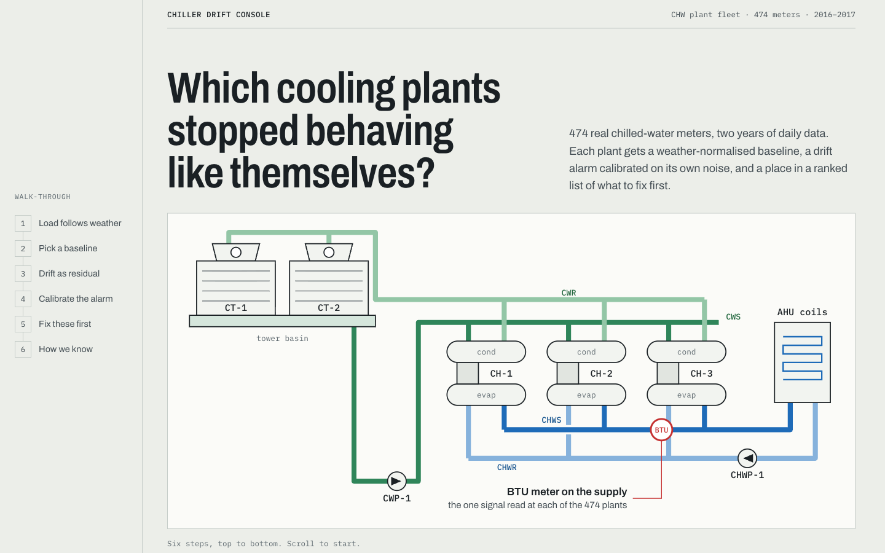
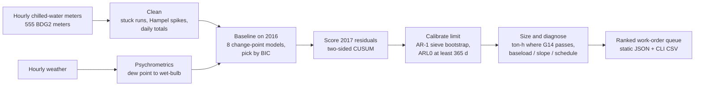

# Chiller Drift Console

**Find the cooling plants that stopped behaving like themselves, and rank them by what the drift costs.**

[](tests/)
[](LICENSE)
[](https://creativecommons.org/licenses/by-sa/4.0/)
[](requirements.txt)
[](package.json)

**[Live demo →](https://ibiraheel.com/demos/chiller-drift-console/)**

[](https://ibiraheel.com/demos/chiller-drift-console/)

---

## The question

When you run many cooling plants, how do you tell a plant that has really drifted from one that just had a hot, humid week? And which one do you send a technician to first?

## The answer

Measured on 474 real chilled-water plants (Building Data Genome Project 2, 2016 to 2017), each judged against its own weather baseline:

- **165 of 474 plants drifted up** in 2017.
- The textbook alarm limit flags **98 % of plants** (463 of 474). A limit calibrated on each plant's real, autocorrelated residuals holds about **one false alarm per plant-year**.
- **8 plants carry half** of the 13.1 million ton-hours of excess that the baselines are good enough to size.

## The solution

- **A one-page playbook**, [SOLUTION.md](SOLUTION.md): baseline every plant, calibrate the alarm on real residuals, cost only what the baseline supports, and turn each alarm into a ranked work order with first checks.
- **A one-command tool**, `tools/drift_check.py`: meters and weather in, `queue.csv` and `summary.md` out. It runs on any data in the same layout.

---

## Key results

| Result | Value |
|---|---|
| Meters in the dataset → modelled | 555 (11 sites) → 474 (10 sites) |
| Plants drifting up in 2017 (calibrated limit, h = 16) | 165 (232 down, 77 in control) |
| Plants alarming at the textbook limit (h = 5) | 463 of 474 (98 %) |
| In-control run length on real residuals, h = 5 vs h = 16 | 49 days vs 394 days |
| Upward alarms with a baseline good enough to size | 52 of 165 |
| Sized excess | 13.1 million ton-h (7.9 GWh electric at 0.6 kW/ton) |
| Plants carrying 50 % / 80 % of it | 8 / 18 |
| Median sized excess over baseline | 11.1 % |
| Pattern of the 165 upward alarms | baseload 109 · slope 55 · schedule 1 |

Every number is written by `pipeline/run.py` to `public/data/summary.json` and `queue.json`. Nothing is typed in by hand.

## ML vs baseline

Two comparisons, both on the same data, reported as they came out.

**Weather baseline, scored on held-out 2017** (share of meters meeting ASHRAE Guideline 14):

| Model | Meets G14 | Median CV(RMSE) | Verdict |
|---|---|---|---|
| Change-point regression (best of 8 by BIC) | 28.5 % | 34.2 % | kept: same accuracy, physical parameters |
| Gradient-boosted trees (scikit-learn) | 28.5 % | 36.6 % | **tie** with change-point |
| Same weekday last year (naive) | 5.1 % | 59.9 % | **loses** to both models |

**Drift detector vs a "month over 10 %" review** (132 labelled synthetic steps per size, added to real 2017 residuals):

| Step size | CUSUM detects | Monthly review detects | Verdict |
|---|---|---|---|
| +20 % | 98.5 % (median 26.5 d) | 84.1 % (median 27 d); 15.9 % flag before the fault exists | **CUSUM wins** |
| +10 % | 74.2 % (median 67 d) | 71.2 % (median 48 d) | **tie** on detection; the monthly review is faster |
| +5 % | 47.7 % | 62.1 % | **CUSUM loses**; neither is reliable at this size |

On the real 2017 alarms the CUSUM is not faster: it fires a median 3 days after the monthly review (161 plants where both fired). What it buys you is a known false-alarm rate. On in-control 2016 data the monthly review flags 1.45 months per meter-year and fires at least once on 73 % of compliant meters.

## How it works



The equations (change-point forms, CV(RMSE) and NMBE, tabular CUSUM, sieve bootstrap, Stull wet-bulb), assumptions and validation are in [METHOD.md](METHOD.md). The tests cover a closed-form OLS hand calculation, the published CUSUM ARL table (Montgomery, Table 9.3: ARL₀ = 465, ARL(1σ) = 10.4) and psychrometric chart values.

## Quickstart

You need Python 3.11+ (tested on 3.12) and Node 18+. The three BDG2 files (`chilledwater_cleaned.csv`, `weather.csv`, `metadata.csv`) come from the [BDG2 repository](https://github.com/buds-lab/building-data-genome-project-2) (`data/meters/cleaned/`, `data/weather/`, `data/metadata/`). Keep them in a folder outside this repo.

```bash
# 1. Python environment
python3 -m venv .venv && .venv/bin/pip install -r requirements.txt

# 2. Run the pipeline: writes public/data/*.json (under 2 minutes)
.venv/bin/python -I pipeline/run.py ../bdg2 public/data

# 3. Run the tests (the two full-data tests skip unless BDG2_DIR points at the files)
BDG2_DIR=../bdg2 .venv/bin/python -I -m pytest -q

# 4. Run the tool
.venv/bin/python -I tools/drift_check.py \
  --meters ../bdg2/chilledwater_cleaned.csv --weather ../bdg2/weather.csv \
  --metadata ../bdg2/metadata.csv --calibrate --kw-per-ton 0.6 --out out/
# -> 474 plants, h = 16, 165 drift up, 8 plants = 50 % of 13,087,159 ton-h -> out/queue.csv

# 5. Run the demo
npm install
npm run dev          # open http://localhost:5173/demos/chiller-drift-console/
npm run build        # static site in dist/, built for /demos/chiller-drift-console/
```

The demo reads only the precomputed JSON in `public/data/`. It needs no server and no API keys.

## Repo layout

```
pipeline/        clean.py · psychro.py · changepoint.py · cusum.py · run.py
tools/           drift_check.py: the pipeline as a CLI
tests/           14 pytest checks (hand calcs, published tables, CLI vs queue.json)
public/data/     summary.json · queue.json · fleet.json · detail/<plant>.json
src/             React walk-through: weather, baseline, drift, alarm, queue, proof
docs/img/        screenshots
METHOD.md        equations, assumptions, validation, limitations
SOLUTION.md      the playbook, decision thresholds and the tool
```

## Limitations

- **Campus and commercial buildings, not mission-critical plants.** A data-center cooling load is flatter and follows IT load as much as weather; a real deployment would add IT kW as a regressor and validate on one site's history first.
- **Daily resolution.** Hourly models would detect faster, at the cost of modelling the daily profile.
- **An alarm is not a diagnosis.** The CUSUM cannot tell a fault from a legitimate change (new occupants, a lab added, a term schedule), so every alarm becomes a ranked checklist, not an automatic work order.
- **Only 52 of 165 upward alarms can be costed.** The rest fail the Guideline 14 or units checks and are ranked by mean z-score after onset instead.
- **Small drifts stay hidden.** A +5 % step is below what either method finds reliably within a season on data this noisy.

## Data and credit

Meter and weather data: **Building Data Genome Project 2**. Miller, C., Kathirgamanathan, A., Picchetti, B. et al. (2020). *The Building Data Genome Project 2, energy meter data from the ASHRAE Great Energy Predictor III competition.* Scientific Data 7, 368. [doi:10.1038/s41597-020-00712-x](https://doi.org/10.1038/s41597-020-00712-x). Repository: [buds-lab/building-data-genome-project-2](https://github.com/buds-lab/building-data-genome-project-2).

The data is licensed [CC BY-SA 4.0](https://creativecommons.org/licenses/by-sa/4.0/), and the derived JSON in `public/data/` is shared under the same licence. The code is MIT ([LICENSE](LICENSE)). The only synthetic data are the labelled step faults used to test the detector.

## Author

**Ibi Raheel**, mechanical engineer building AI tools · [ibiraheel.com](https://ibiraheel.com)
